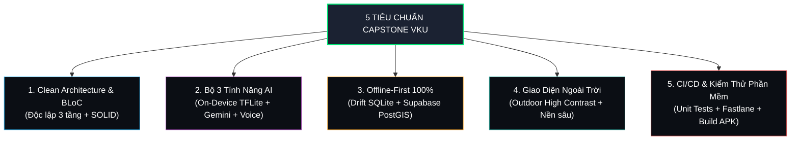
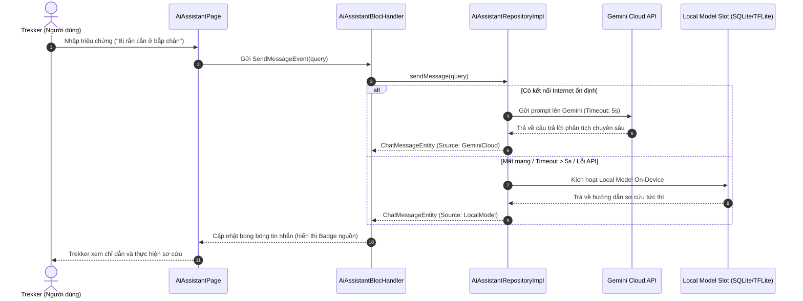

# 🏔️ TrekGuard AI — Tài Liệu Kiến Trúc & Kỹ Thuật Toàn Diện Dự Án

> **Đề tài:** Ứng dụng Di động Hỗ trợ Trekking Ngoại tuyến Tích hợp Trí tuệ Nhân tạo Đa tầng (TrekGuard AI)  
> **Cấp độ:** Đồ án Tốt nghiệp Kỹ sư CNTT / Capstone Project — Đại học CNTT & TT Việt - Hàn (VKU)  
> **Giảng viên hướng dẫn:** TS. Nguyễn Thanh Tuấn  
> **Phiên bản tài liệu:** v2.0 (Cập nhật sau tích hợp toàn diện)  
> **Mã nguồn Repository:** [github.com/pdthang125/Trekking](https://github.com/pdthang125/Trekking)

---

## MỤC LỤC
1. [Đối Soát Yêu Cầu Đề Tài Capstone VKU (5 Tiêu Chuẩn)](#1-đối-soát-yêu-cầu-đề-tài-capstone-vku-5-tiêu-chuẩn)
2. [Kiến Trúc Hệ Thống Tổng Thể (System Architecture)](#2-kiến-trúc-hệ-thống-tổng-thể-system-architecture)
3. [Giải Thích Toàn Bộ Các Thư Mục Trong Dự Án](#3-giải-thích-toàn-bộ-các-thư-mục-trong-dự-án)
4. [Danh Mục Thư Viện Sử Dụng (Tech Stack & Dependencies)](#4-danh-mục-thư-viện-sử-dụng-tech-stack--dependencies)
5. [Các Luồng Nghiệp Vụ Cốt Lõi (Core Workflows)](#5-các-luồng-nghiệp-vụ-cốt-lõi-core-workflows)
6. [Kế Hoạch & Phân Công Hoàn Thiện (Sprint Roadmap)](#6-kế-hoạch--phân-công-hoàn-thiện-sprint-roadmap)

---

## 1. ĐỐI SOÁT YÊU CẦU ĐỀ TÀI CAPSTONE VKU (5 TIÊU CHUẨN)

Dự án được xây dựng bám sát 100% theo 5 tiêu chuẩn đánh giá khắt khe của Hội đồng Đồ án Tốt nghiệp VKU:



### Chi tiết mức độ đáp ứng:

| Tiêu chuẩn | Yêu cầu chuẩn VKU | Hiện trạng xây dựng thực tế | Vị trí mã nguồn | Đánh giá |
| :--- | :--- | :--- | :--- | :---: |
| **Tiêu chuẩn 1:<br>Clean Architecture & SOLID** | • Phân tách 3 tầng: Domain, Data, Presentation.<br>• Quản lý trạng thái bằng BLoC.<br>• Dependency Injection tự động (IoC). | • Áp dụng chuẩn Clean Architecture cho toàn bộ 6 tính năng.<br>• BLoC 8 quản lý state riêng biệt từng trang.<br>• `GetIt + Injectable` sinh mã tự động 714 files. | [`lib/features/`](file:///d:/Baitaplon/Danentang/Trekking/lib/features/)<br>[`lib/core/di/`](file:///d:/Baitaplon/Danentang/Trekking/lib/core/di/) | **100%**<br>*(Đạt chuẩn tối đa)* |
| **Tiêu chuẩn 2:<br>Bộ 3 Tính năng AI** | **1. AI On-Device:** Phân loại sơ cứu không cần mạng.<br>**2. Gemini Cloud:** Trợ lý chuyên sâu khi có mạng.<br>**3. AI thứ 3 (TTS/Voice):** Đọc to chỉ dẫn cứu hộ khẩn cấp. | • Đã viết bộ tách từ `TfliteTokenizer`.<br>• Tích hợp Gemini Cloud API có Fallback mạng yếu.<br>• Đã nhúng 16 ca cấp cứu SQLite.<br>• Đã tích hợp `flutter_tts`. | [`lib/core/ai/`](file:///d:/Baitaplon/Danentang/Trekking/lib/core/ai/)<br>[`lib/features/ai_assistant/`](file:///d:/Baitaplon/Danentang/Trekking/lib/features/ai_assistant/) | **75%**<br>*(Đang chờ nạp file model.tflite)* |
| **Tiêu chuẩn 3:<br>Offline-First 100%** | • Hoạt động độc lập hoàn toàn khi mất sóng 4G.<br>• Cache cục bộ SQLite.<br>• Tự động đồng bộ 2 chiều lên Supabase PostGIS khi có mạng. | • Đã tạo CSDL Drift SQLite 5 bảng.<br>• `SyncService` tự động lắng nghe kết nối mạng.<br>• Backend PostGIS `schema_v2.sql` sẵn sàng 3 hàm tính toán không gian. | [`lib/core/database/`](file:///d:/Baitaplon/Danentang/Trekking/lib/core/database/)<br>[`docs/supabase/`](file:///d:/Baitaplon/Danentang/Trekking/docs/supabase/) | **85%** |
| **Tiêu chuẩn 4:<br>Outdoor High-Contrast UI** | • Tương phản cực cao dưới ánh nắng gắt.<br>• Phím bấm lớn (≥ 48x48dp) cho người đeo găng tay dã ngoại.<br>• Màu cảnh báo cứu nạn chuẩn quốc tế. | • `AppTheme` chuyên dụng: Nền `#0B0E14`, Neon Green `#00E676`, SOS Red `#FF3B30`.<br>• Hoàn thành khung 5 màn hình chính và HUD theo dõi GPS ngoài thực địa. | [`lib/core/theme/`](file:///d:/Baitaplon/Danentang/Trekking/lib/core/theme/)<br>[`lib/core/pages/`](file:///d:/Baitaplon/Danentang/Trekking/lib/core/pages/) | **85%** |
| **Tiêu chuẩn 5:<br>CI/CD & Chất lượng Mã nguồn** | • Kiểm thử tự động (Unit Test).<br>• Đóng gói APK hoàn chỉnh qua Gradle.<br>• Quy chuẩn Git branch chuyên nghiệp. | • Unit test usecases đạt **5/5 PASS**.<br>• Build APK thành công trên Android Pixel 7 (Gradle 8.10, AGP 8.6, Java 21).<br>• Nhánh `develop` ổn định tuyệt đối. | [`test/unit/`](file:///d:/Baitaplon/Danentang/Trekking/test/unit/)<br>[`android/`](file:///d:/Baitaplon/Danentang/Trekking/android/) | **85%** |

---

## 2. KIẾN TRÚC HỆ THỐNG TỔNG THỂ (SYSTEM ARCHITECTURE)

Dự án áp dụng mô hình **Clean Architecture 3 Lớp Kết Hợp Tầng Cốt Lõi (Core Layer)**:

```
┌────────────────────────────────────────────────────────────────────────┐
│                        PRESENTATION LAYER                              │
│   • Pages (UI Screens)       • Widgets (Custom Components)             │
│   • BLoC Handlers (Events ➔ State Transitions)                         │
└───────────────────────────────────┬────────────────────────────────────┘
                                    │ (gọi UseCases)
                                    ▼
┌────────────────────────────────────────────────────────────────────────┐
│                          DOMAIN LAYER (Core Business)                  │
│   • Entities (Business Models: FirstAidGuide, GpsPoint, SosEvent)     │
│   • Use Cases (GetAllGuides, PredictFirstAid, StartTracking, SendChat)│
│   • Repository Interfaces (Contracts - Dependency Inversion)           │
└───────────────────────────────────▲────────────────────────────────────┘
                                    │ (thực thi Interfaces)
┌───────────────────────────────────┴────────────────────────────────────┐
│                           DATA LAYER                                   │
│   • Repository Implementations (Offline/Online Routing Logic)          │
│   ┌───────────────────────────────┴───────────────────────────────┐    │
│   ▼                                                               ▼    │
│ [LOCAL DATASOURCE]                                    [REMOTE DATASOURCE]│
│ • Drift SQLite (5 bảng)                               • Supabase PostGIS │
│ • File System Tile Cache                              • Gemini Cloud API │
│ • TFLite On-Device Model                             • Restful APIs     │
└────────────────────────────────────────────────────────────────────────┘
                                    ▲
                                    │ (sử dụng hạ tầng nền)
┌───────────────────────────────────┴────────────────────────────────────┐
│                           CORE LAYER                                   │
│ • Dependency Injection (GetIt/Injectable)   • App Router (GoRouter)    │
│ • Database Engine (Drift/SQLite)            • Outdoor App Theme        │
│ • Network Monitor (ConnectivityPlus)        • Unified Failure System   │
└────────────────────────────────────────────────────────────────────────┘
```

---

## 3. GIẢI THÍCH TOÀN BỘ CÁC THƯ MỤC TRONG DỰ ÁN

Dưới đây là sơ đồ cây và chức năng của từng thư mục trong mã nguồn:

### 3.1. Các Thư Mục Gốc (Root Folders)
* [`android/`](file:///d:/Baitaplon/Danentang/Trekking/android/): Chứa mã nguồn Native Android (Kotlin, Gradle 8.10, Manifest, cấu hình quyền GPS, Foreground Service và quyền thông báo SOS).
* [`ios/`](file:///d:/Baitaplon/Danentang/Trekking/ios/): Cấu hình Native iOS (Runner, Podfile, Info.plist khai báo quyền định vị nền).
* [`assets/`](file:///d:/Baitaplon/Danentang/Trekking/assets/):
  * `assets/data/`: Chứa file dữ liệu nạp ban đầu [`first_aid_guides.json`](file:///d:/Baitaplon/Danentang/Trekking/assets/data/first_aid_guides.json) (16 ca cấp cứu) và script Python sinh dữ liệu [`genData.py`](file:///d:/Baitaplon/Danentang/Trekking/assets/data/genData.py).
  * `assets/models/`: Thư mục lưu trữ mô hình trí tuệ nhân tạo ngoại tuyến (`model.tflite` và `labels.txt`).
  * `assets/icons/`, `assets/images/`: Chứa logo, đồ họa SVG và biểu tượng dã ngoại.
* [`docs/`](file:///d:/Baitaplon/Danentang/Trekking/docs/): Tài liệu kỹ thuật, hướng dẫn huấn luyện AI (`ai_pipeline/`), nhật ký phát triển (`MEMBER2_BACKEND_LOG.md`) và mã nguồn SQL Supabase (`docs/supabase/schema_v2.sql`).
* [`fastlane/`](file:///d:/Baitaplon/Danentang/Trekking/fastlane/): Cấu hình tự động hóa CI/CD, đóng gói APK và phát hành phiên bản thử nghiệm.
* [`test/`](file:///d:/Baitaplon/Danentang/Trekking/test/): Bộ kiểm thử tự động, chứa các bài Unit Test kiểm tra tính đúng đắn của logic nghiệp vụ (`test/unit/features/first_aid/`).

---

### 3.2. Chi Tiết Thư Mục Cốt Lõi ([`lib/core/`](file:///d:/Baitaplon/Danentang/Trekking/lib/core/))
Đóng vai trò là "xương sống" cung cấp hạ tầng dùng chung cho toàn bộ app:

1. [`lib/core/ai/`](file:///d:/Baitaplon/Danentang/Trekking/lib/core/ai/):
   * Chứa bộ tiền xử lý ngôn ngữ tự nhiên [`tflite_tokenizer.dart`](file:///d:/Baitaplon/Danentang/Trekking/lib/core/ai/tflite_tokenizer.dart) để bóc tách từ ngữ triệu chứng và chuyển đổi thành Tensor số học cho mô hình On-Device.
2. [`lib/core/database/`](file:///d:/Baitaplon/Danentang/Trekking/lib/core/database/):
   * Chứa file cơ sở dữ liệu [`app_database.dart`](file:///d:/Baitaplon/Danentang/Trekking/lib/core/database/app_database.dart). Định nghĩa 5 bảng SQLite:
     * `FirstAidGuides`: Hướng dẫn cấp cứu.
     * `TrackPoints`: Điểm tọa độ GPS thu thập thời gian thực.
     * `Waypoints`: Điểm cắm cờ mốc địa lý cá nhân.
     * `Trips`: Thông tin các chuyến đi trekking.
     * `SosEvents`: Lịch sử các lần phát tín hiệu cứu hộ khẩn cấp.
3. [`lib/core/di/`](file:///d:/Baitaplon/Danentang/Trekking/lib/core/di/):
   * Chứa [`injection_container.dart`](file:///d:/Baitaplon/Danentang/Trekking/lib/core/di/injection_container.dart): Cấu hình IoC Container (`GetIt` + `Injectable`), chịu trách nhiệm tiêm phụ thuộc tự động.
4. [`lib/core/env/`](file:///d:/Baitaplon/Danentang/Trekking/lib/core/env/):
   * Chứa [`env.dart`](file:///d:/Baitaplon/Danentang/Trekking/lib/core/env/env.dart): Đọc an toàn các biến môi trường bí mật từ file `.env` (Supabase Key, Gemini Key).
5. [`lib/core/error/`](file:///d:/Baitaplon/Danentang/Trekking/lib/core/error/):
   * Chứa [`failures.dart`](file:///d:/Baitaplon/Danentang/Trekking/lib/core/error/failures.dart): Chuẩn hóa các lớp lỗi hệ thống (`NetworkFailure`, `CacheFailure`, `ServerFailure`, `AIInferenceFailure`).
6. [`lib/core/network/`](file:///d:/Baitaplon/Danentang/Trekking/lib/core/network/):
   * [`network_info.dart`](file:///d:/Baitaplon/Danentang/Trekking/lib/core/network/network_info.dart): Giám sát trạng thái kết nối mạng WiFi/4G.
   * [`sync_service.dart`](file:///d:/Baitaplon/Danentang/Trekking/lib/core/network/sync_service.dart): Dịch vụ chạy nền tự động kích hoạt đẩy dữ liệu SQLite lên Supabase khi phát hiện có mạng trở lại.
7. [`lib/core/router/`](file:///d:/Baitaplon/Danentang/Trekking/lib/core/router/):
   * Chứa [`app_router.dart`](file:///d:/Baitaplon/Danentang/Trekking/lib/core/router/app_router.dart): Cấu hình GoRouter, phân luồng đăng nhập, ShellRoute ghim cố định Bottom Navigation Bar 5 tab.
8. [`lib/core/theme/`](file:///d:/Baitaplon/Danentang/Trekking/lib/core/theme/app_theme.dart):
   * Chứa [`app_theme.dart`](file:///d:/Baitaplon/Danentang/Trekking/lib/core/theme/app_theme.dart): Bảng màu tương phản cao ngoài trời (Outdoor High Contrast).

---

### 3.3. Chi Tiết Thư Mục Tính Năng ([`lib/features/`](file:///d:/Baitaplon/Danentang/Trekking/lib/features/))

Mỗi thư mục đại diện cho một phân hệ độc lập hoàn chỉnh theo Clean Architecture:

#### 🚑 1. `lib/features/first_aid/` (Sơ cứu Y tế Dã ngoại)
* **Domain:** `first_aid_entities.dart`, `first_aid_usecases.dart`, `first_aid_repository.dart`.
* **Data:** Tra cứu dữ liệu từ file JSON và bảng SQLite cục bộ `FirstAidGuides`.
* **Presentation:**
  * [`FirstAidBlocHandler`](file:///d:/Baitaplon/Danentang/Trekking/lib/features/first_aid/presentation/bloc/first_aid_bloc_handler.dart): Điều khiển tìm kiếm triệu chứng và lọc mức độ nghiêm trọng (Danger / Warning / Safe).
  * [`FirstAidPage`](file:///d:/Baitaplon/Danentang/Trekking/lib/features/first_aid/presentation/pages/first_aid_page.dart): Giao diện hiển thị các thẻ hướng dẫn sơ cứu nhanh.

#### 🗺️ 2. `lib/features/navigation/` (Bản đồ Ngoại tuyến & Định vị GPS)
* **Domain:** Thực thể `GpsPoint`, `Waypoint`, `TripSession` và các usecase điều khiển tracking.
* **Data:** Bắt sóng GPS từ cảm biến phần cứng điện thoại, ghi dữ liệu vào bảng `TrackPoints`.
* **Presentation:**
  * [`NavigationPage`](file:///d:/Baitaplon/Danentang/Trekking/lib/features/navigation/presentation/pages/navigation_page.dart): Bản đồ OpenStreetMap hiển thị dải Polyline tọa độ thực tế.
  * [`OfflineMapManagerPage`](file:///d:/Baitaplon/Danentang/Trekking/lib/features/navigation/presentation/pages/offline_map_manager_page.dart): Giao diện quản lý tải trước các gói bản đồ ngoại tuyến (Sơn Trà, Bà Nà, Hải Vân, Tà Năng).
  * `waypoint_dialog.dart`: Hộp thoại đánh dấu mốc tọa độ dã ngoại.

#### 📈 3. `lib/features/trail/` (Lộ trình & Phân tích Độ cao)
* **Presentation:**
  * [`TrailPage`](file:///d:/Baitaplon/Danentang/Trekking/lib/features/trail/presentation/pages/trail_page.dart): Sử dụng thư viện `fl_chart` để vẽ đồ thị trắc diện độ cao (Altitude Profile) trực quan theo quãng đường di chuyển (km).

#### 🚨 4. `lib/features/sos/` (Trung tâm Cứu nạn Khẩn cấp SOS)
* **Domain & Data:** Entity `SosEvent`, lưu nhật ký tọa độ khi kích hoạt còi hoặc phát tín hiệu khẩn cấp, sẵn sàng đẩy lên máy chủ cứu hộ cứu nạn.
* **Presentation:** Tích hợp trực tiếp vào nút khẩn cấp trên màn hình chính (`HomePage`).

#### 🤖 5. `lib/features/ai_assistant/` (Trợ lý Dã ngoại Hybrid Gemini + On-Device)
* **Domain:** `chat_message_entity.dart`, `ai_chat_usecases.dart`.
* **Data:**
  * `AiRemoteDatasource`: Gửi truy vấn lên Google Gemini 1.5 Flash Cloud.
  * `AiLocalDatasource`: Cơ chế Fallback chạy Offline bằng SQLite và TFLite On-Device.
  * `AiAssistantRepositoryImpl`: Bộ điều phối mạng nhanh / mạng yếu / mất mạng.
* **Presentation:**
  * [`AiAssistantPage`](file:///d:/Baitaplon/Danentang/Trekking/lib/features/ai_assistant/presentation/pages/ai_assistant_page.dart): Giao diện khung chat với các câu hỏi gợi ý nhanh và huy hiệu nhận diện nguồn câu trả lời (Online vs Offline).

#### 🔐 6. `lib/features/auth/` (Quản lý Định danh Người dùng)
* Tầng đăng nhập, đăng ký bằng email và chế độ khách vô danh (Anonymous Guest) để người dùng có thể sử dụng ngay lập tức khi khẩn cấp mà không bị rào cản tài khoản.

---

## 4. DANH MỤC THƯ VIỆN SỬ DỤNG (TECH STACK & DEPENDENCIES)

Toàn bộ thư viện được đóng băng tại [`pubspec.yaml`](file:///d:/Baitaplon/Danentang/Trekking/pubspec.yaml) ở phiên bản ổn định cao nhất, không xảy ra xung đột:

### 4.1. Kiến Trúc & Quản Lý Trạng Thái
* `flutter_bloc: ^8.1.6` & `bloc: ^8.1.4`: Thư viện quản lý trạng thái chuẩn doanh nghiệp, đảm bảo nguyên tắc luồng dữ liệu 1 chiều (Unidirectional Data Flow).
* `equatable: ^2.0.5`: So sánh giá trị của Object (Entity, State, Event) mà không cần override toán tử `==`.
* `dartz: ^0.10.1`: Lập trình hướng hàm (Functional Programming), hỗ trợ kiểu trả về `Either<Failure, Success>` bắt lỗi an toàn.

### 4.2. Dependency Injection & Cấu Trúc
* `get_it: ^7.7.0`: Service Locator hiệu năng cao dùng để truy xuất các service dùng chung trong app.
* `injectable: ^2.4.4`: Trình tạo mã tự động cho `get_it` qua các annotation (`@singleton`, `@injectable`).

### 4.3. Cơ Sở Dữ Liệu Cục Bộ (Offline-First)
* `drift: ^2.18.0` & `drift_flutter: 0.2.2`: Hệ quản trị cơ sở dữ liệu SQLite dạng Reactive (Type-safe), tự động sinh mã SQL an toàn.
* `sqlite3_flutter_libs: ^0.5.22`: Thư viện C-native SQLite3 tối ưu hóa cho từng kiến trúc chip điện thoại (ARM64, x86_64).
* `flutter_secure_storage: ^10.3.4`: Lưu trữ an toàn mã token và thông tin xác thực mã hóa.

### 4.4. Trí Tuệ Nhân Tạo & Xử Lý Âm Thanh
* `tflite_flutter: ^0.10.4`: Chạy mô hình học sâu On-Device TensorFlow Lite trực tiếp trên nhân NPU/CPU của điện thoại, không cần mạng.
* `google_generative_ai: ^0.4.6`: SDK chính thức của Google để kết nối và tương tác với các mô hình Gemini Pro / Gemini Flash.
* `flutter_tts: ^4.0.2`: Bộ máy chuyển văn bản thành giọng nói (Text-To-Speech) đọc hướng dẫn cấp cứu khi người dùng không thể nhìn màn hình.

### 4.5. Bản Đồ, Vị Trí & Cảm Biến
* `flutter_map: ^7.0.2`: Bộ thư viện bản đồ mã nguồn mở mạnh mẽ, hỗ trợ render các mảnh gạch bản đồ OpenStreetMap và cơ chế caching ngoại tuyến.
* `latlong2: ^0.9.1`: Xử lý phép tính toán tọa độ địa lý, khoảng cách giữa 2 điểm kinh độ/vĩ độ.
* `geolocator: ^13.0.1`: Truy xuất tọa độ GPS phần cứng với độ chính xác cao và chạy ngầm nền (Background location).
* `flutter_compass: ^0.8.0`: Đọc la bàn điện tử từ con quay hồi chuyển của máy.

### 4.6. Đám Mây & Đồng Bộ Mạng
* `supabase_flutter: ^2.5.6`: SDK kết nối dịch vụ Backend-as-a-Service (PostgreSQL + PostGIS, Auth, Storage).
* `connectivity_plus: ^6.0.5`: Lắng nghe thay đổi kết nối mạng thời gian thực để kích hoạt `SyncService`.

### 4.7. Giao Diện & Trực Quan Hóa Dữ Liệu
* `go_router: ^14.2.7`: Điều hướng màn hình khai báo (Declarative Routing) có hỗ trợ Deep Linking và ShellRoute.
* `fl_chart: ^0.69.0`: Vẽ đồ thị trắc diện độ cao (LineChart) mượt mà cho tính năng trekking trail.
* `google_fonts: ^6.2.1`: Tích hợp các bộ font chữ ngoài trời dễ đọc (Inter, Roboto Mono).

---

## 5. CÁC LUỒNG NGHIỆP VỤ CỐT LÕI (CORE WORKFLOWS)

### 5.1. Luồng Trợ Lý AI Hybrid (Gemini Cloud + On-Device Fallback)



---

## 6. KẾ HOẠCH & PHÂN CÔNG HOÀN THIỆN (SPRINT ROADMAP)

* **Leader (Bạn):**
  1. Hoàn tất kết nối GPS thời gian thực ghi dòng vào SQLite `TrackPoints`.
  2. Nạp khóa API Gemini cá nhân miễn phí và khớp tên model `gemini-1.5-flash-latest`.
  3. Xây dựng tài liệu thuyết minh kiến trúc và slide bảo vệ đồ án trước Hội đồng.
* **Member 2 (Trí):**
  1. Hoàn tất tập dữ liệu 150+ mẫu sơ cứu trong `assets/data/first_aid_dataset_template.csv`.
  2. Chạy pipeline huấn luyện xuất ra file `model.tflite` + `labels.txt` đặt vào `assets/models/`.
  3. Cắm model vào đúng vị trí `Local Model Slot` đã chừa sẵn trong `AiLocalDatasource`.
* **Member 3:**
  1. Hoàn thiện giao diện đồ họa cho trang Bản đồ (`navigation_page.dart`) và Lộ trình (`trail_page.dart`).
  2. Vẽ Poster và Slide thuyết trình Capstone theo quy chuẩn nhận diện thương hiệu VKU.

---
*Tài liệu được khởi tạo và lưu trữ an toàn trong kho mã nguồn dự án TrekGuard AI.*
